<a href="https://byarman.site">
  <picture>
    <source media="(prefers-color-scheme: dark)" srcset="assets/header-dark.svg">
    <source media="(prefers-color-scheme: light)" srcset="assets/header-light.svg">
    
  </picture>
</a>

I build products with AI, in Slemani, Kurdistan.

### [Meds.krd](https://www.meds.krd)

A study platform for medical students in Kurdistan: their own lectures, a plan for today, and practice that remembers what each student gets wrong. [How it's built](https://github.com/arman-mahabad/meds.krd)

### The Lecture Machine, inside Meds.krd

Several AI models, from different companies, turn a lecture into readable parts and practice questions. None of them checks its own writing, and anything that fails twice waits for a person.

### [Fine Print](https://github.com/arman-mahabad/fine-print)

A Claude skill for long AI-built projects. Before the agent calls a feature done, it has to write down where the feature works, how that was seen, and what the check does not prove.

### [Sorani skill](https://github.com/arman-mahabad/sorani-skill)

A Claude skill that helps Claude write Sorani Kurdish with Kurdish letters instead of Arabic lookalikes, and show it right to left. Its checker finds the common mistakes and fixes the safe ones.

More of my work, and my CV: [byarman.site](https://byarman.site)

[arman@byarman.site](mailto:arman@byarman.site) &nbsp;·&nbsp; [LinkedIn](https://www.linkedin.com/in/arman-mahabad)
