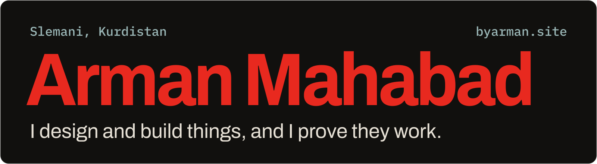
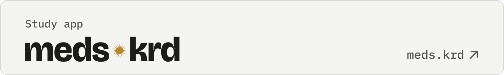
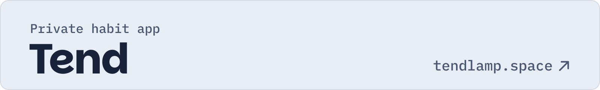
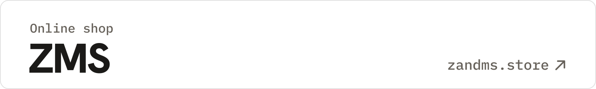
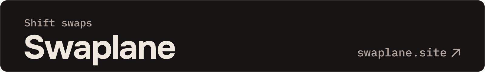

Apps, a shop, a marketing business, and the AI systems inside them. More on each one, and my CV, at [byarman.site](https://byarman.site).

 

### Work

A study platform for medical students in Kurdistan: their own lectures, a plan for today, and practice that remembers what each student gets wrong. [Code](https://github.com/arman-mahabad/meds.krd)

A private habit app: pick a goal and try one small change at a time. No streaks, no shame, and the server can't read your notes. [Code](https://github.com/arman-mahabad/tend-app)

An online shop for a phone-parts business, Kurdish first with English beside it, run from the owner's phone. Live 9 days after the first line of code. [Code](https://github.com/arman-mahabad/zandms.store)

A shift-swap app for teams that work in shifts. You say how you want your week to look, and it finds swaps that are fair to both people. [Code](https://github.com/arman-mahabad/swaplane.site)

A marketing business for US dental practices. I built and run it: the website, the way it researches practices, and the CRM behind it. [Code](https://github.com/arman-mahabad/armanleads.com)

 

### How I check my work

**The Lecture Machine**, inside Meds.krd. Several AI models, from different companies, turn a lecture into readable parts and practice questions. None of them checks its own writing, and anything that fails twice waits for a person.

**[Fine Print](https://github.com/arman-mahabad/fine-print)**. A Claude skill for long AI-built projects. Before the agent calls a feature done, it has to write down where the feature works, how that was seen, and what the check does not prove.

**[Kunji](https://github.com/arman-mahabad/kunji)**. A working prototype of an AI copilot that helps people write and check their replies. It never sends anything by itself, and it comes with a workspace for measuring how well it works.

**[Sorani skill](https://github.com/arman-mahabad/sorani-skill)**. Helps Claude write Sorani Kurdish with Kurdish letters instead of Arabic lookalikes, right to left. Its checker finds the common mistakes and fixes the safe ones.

 

[byarman.site](https://byarman.site) &nbsp;·&nbsp; [arman@byarman.site](mailto:arman@byarman.site) &nbsp;·&nbsp; [LinkedIn](https://www.linkedin.com/in/arman-mahabad)

The pictures on this page are drawn from each project's own fonts by [one small script](make/pictures.mjs).
